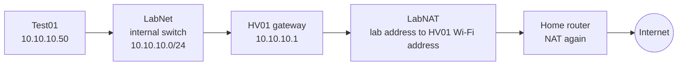
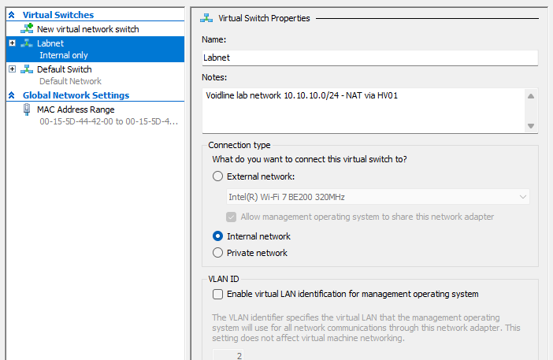
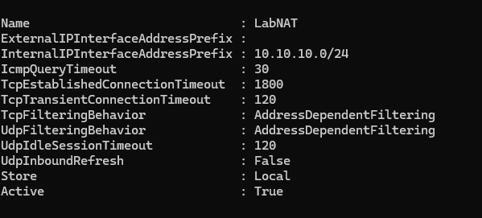
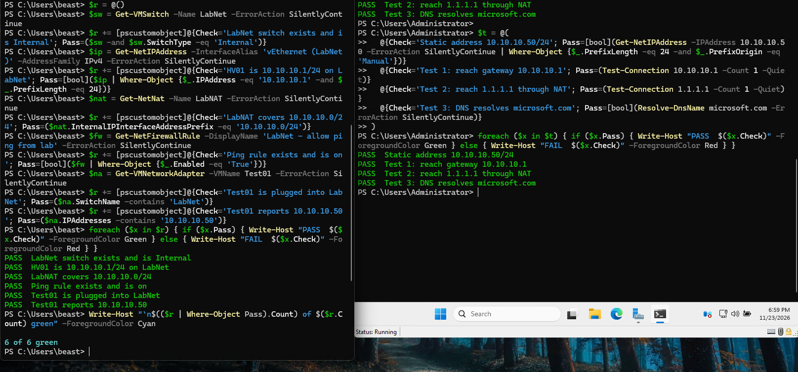

# Chapter 1: Windows Server and the lab build

Working notes for Chapter 1 of my homelab. The lab plays the part of a small MSP looking after a fictional client, Voidline Audio. Each lesson has a goal, what I built, how I tested it, and what I learned.

## Lesson 1: Building the lab network (LabNet)

**Goal:** Give the lab its own private network with addresses that never change, so servers can always be found at the same address. Hyper-V's built-in Default Switch can pick a new address range when the host restarts, which would break a domain controller later in the course.

### What I built

| Item | Value | What it is for |
| --- | --- | --- |
| Virtual switch | LabNet (Internal) | Connects HV01 and the lab VMs on a private network of their own. Unlike the Default Switch, its addresses never change. |
| Host gateway | vEthernet (LabNet) = 10.10.10.1/24 | The lab's door: VMs send any traffic for other networks to 10.10.10.1, and HV01 passes it out through NAT. |
| NAT | LabNAT for 10.10.10.0/24 | Translates the lab's private 10.10.10.x addresses to HV01's own Wi-Fi address on the way out, and back again on replies. The home router then translates a second time to reach the internet (double NAT). |
| Firewall rule | Allow ping (ICMPv4 type 8) on LabNet only | Lets lab machines ping HV01 so test 1 works. It only applies to the LabNet adapter, so the home network still cannot ping HV01 (least privilege). |
| Test01 | 10.10.10.50/24, gateway 10.10.10.1, DNS 1.1.1.1 / 8.8.8.8 | A test server for checking the lab network. It has a static address because servers need an address that never changes, and LabNet has no DHCP server yet. |

### Address plan (10.10.10.0/24)

| Addresses | Used for |
| --- | --- |
| .1 | Gateway (HV01 now, a firewall VM later in the course) |
| .10 - .49 | Servers |
| .50 - .99 | Test machines |
| .100 - .199 | Client PCs through DHCP (later in the course) |
| .2 - .9, .200 - .254 | Kept free |

### Test results

Three tests run inside Test01, each one reaching a step further away. The first one that fails shows where a fault is.

| Test | What it tests | First try | After firewall rule | After restarting HV01 |
| --- | --- | --- | --- | --- |
| ping 10.10.10.1 | Reach the gateway | Fail | Pass | Pass |
| ping 1.1.1.1 | Get out to the internet through NAT | Pass | Pass | Pass |
| Resolve-DnsName microsoft.com | DNS name lookup | Pass | Pass | Pass |

Test 1 failed at first because HV01 treats LabNet as a public network and blocks incoming ping. Traffic was still passing through HV01, which is why test 2 passed. After restarting HV01, the Default Switch came back with a different address but LabNet stayed at 10.10.10.1.

**Automated check:** two PowerShell scripts check every piece (switch, gateway address, NAT, firewall rule, Test01's adapter and address, and all three tests). Result: 6 of 6 checks passed on HV01 and 4 of 4 inside Test01.

### Incident INC-002

A practice incident: a script broke one random part of the lab network, and I had to find and fix it.

- **Symptom:** Test01 could not reach the internet.
- **How I found it:** `Get-NetNat` on HV01 returned nothing, so the NAT translation was missing.
- **Fix:** recreated it with `New-NetNat -Name "LabNAT" -InternalIPInterfaceAddressPrefix 10.10.10.0/24`.
- **Verified:** the check scripts were all green again.

### What I learned

- A device needs a default gateway to talk to anything outside its own network. NAT is a separate job: it is only needed when private addresses have to reach a network that does not know about them, such as the internet.
- A firewall can block ping, so a failed ping does not prove a device is down. Test 1 failed while traffic was still flowing through the same gateway.
- A 169.254.x.x address means a device asked for DHCP and nobody answered.
