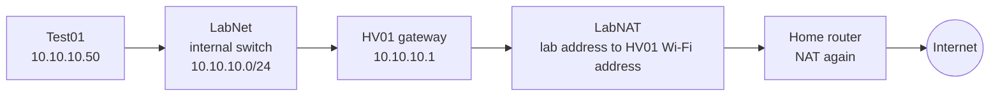
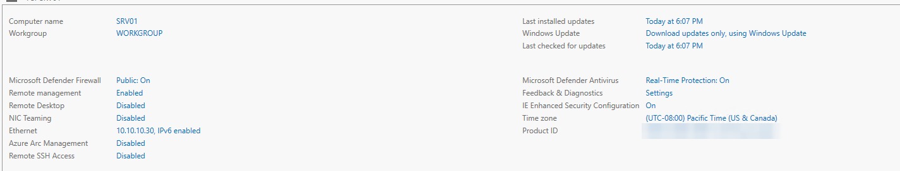
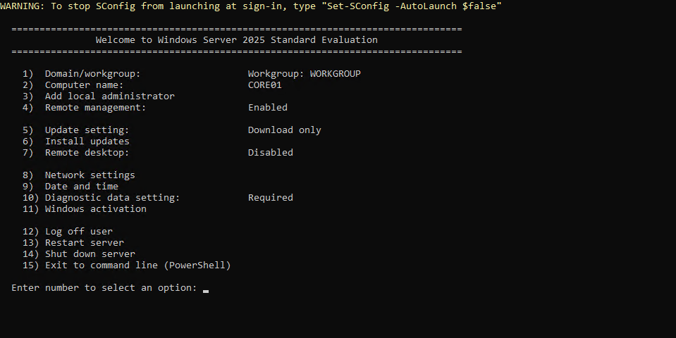
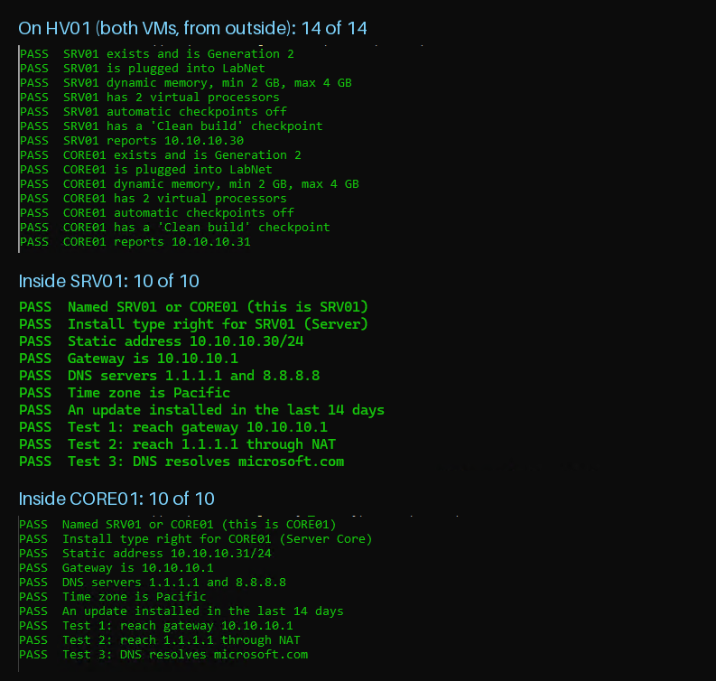
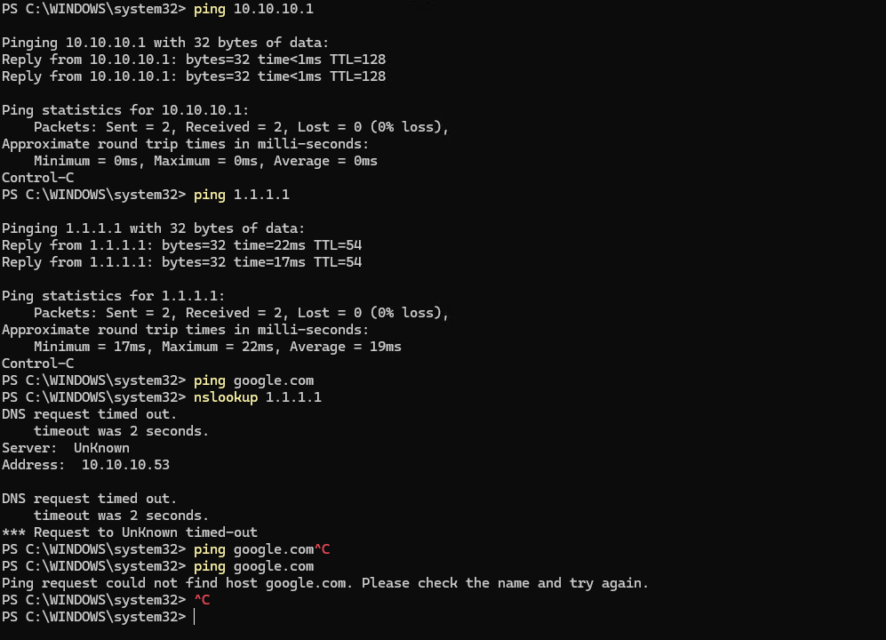

# Chapter 1: Windows Server and the lab build

Working notes for Chapter 1 of my homelab. The lab plays the part of a small MSP looking after a fictional client, Voidline Audio. Each lesson has a goal, what I built, how I tested it, and what I learned.

## Lesson 1: Building the lab network (LabNet)

**Goal:** Give the lab its own private network with addresses that never change, so servers can always be found at the same address. Hyper-V's built-in Default Switch can pick a new address range when the host restarts, which would break a domain controller later in the course.

### What I built

| Item | Value | What it is for |
| --- | --- | --- |
| Virtual switch | LabNet (Internal) | Connects HV01 and the lab VMs on a private network of their own. Unlike the Default Switch, its addresses never change. |
| Host gateway | vEthernet (LabNet) = 10.10.10.1/24 | The lab's door: VMs send any traffic for other networks to 10.10.10.1, and HV01 passes it out through NAT. |
| NAT | LabNAT for 10.10.10.0/24 | Translates the lab's private 10.10.10.x addresses to HV01's own Wi-Fi address on the way out, and back again on replies. The home router then translates a second time to reach the internet (double NAT). |
| Firewall rule | Allow ping (ICMPv4 type 8) on LabNet only | Lets lab machines ping HV01 so test 1 works. It only applies to the LabNet adapter, so the home network still cannot ping HV01 (least privilege). |
| Test01 | 10.10.10.50/24, gateway 10.10.10.1, DNS 1.1.1.1 / 8.8.8.8 | A test server for checking the lab network. It has a static address because servers need an address that never changes, and LabNet has no DHCP server yet. |

### Address plan (10.10.10.0/24)

| Addresses | Used for |
| --- | --- |
| .1 | Gateway (HV01 now, a firewall VM later in the course) |
| .10 - .49 | Servers |
| .50 - .99 | Test machines |
| .100 - .199 | Client PCs through DHCP (later in the course) |
| .2 - .9, .200 - .254 | Kept free |

### Test results

Three tests run inside Test01, each one reaching a step further away. The first one that fails shows where a fault is.

| Test | What it tests | First try | After firewall rule | After restarting HV01 |
| --- | --- | --- | --- | --- |
| ping 10.10.10.1 | Reach the gateway | Fail | Pass | Pass |
| ping 1.1.1.1 | Get out to the internet through NAT | Pass | Pass | Pass |
| Resolve-DnsName microsoft.com | DNS name lookup | Pass | Pass | Pass |

Test 1 failed at first because HV01 treats LabNet as a public network and blocks incoming ping. Traffic was still passing through HV01, which is why test 2 passed. After restarting HV01, the Default Switch came back with a different address but LabNet stayed at 10.10.10.1.

**Automated check:** two PowerShell scripts check every piece (switch, gateway address, NAT, firewall rule, Test01's adapter and address, and all three tests). Result: 6 of 6 checks passed on HV01 and 4 of 4 inside Test01.

### Incident INC-002: lab VMs lost internet access

**What this exercise is:** every lesson ends with a practice incident. A script I am not allowed to read breaks one random part of what I just built, then prints only what a user would report, like a real support ticket. I have to find the cause, fix it and write it up the way an MSP technician would. It practises troubleshooting from symptoms, not from knowing the answer.

**The ticket:** "Test01 can't reach the internet." No other details.

**Environment:** HV01 (Hyper-V host) routes the lab network LabNet (10.10.10.0/24) out to the internet through a NAT called LabNAT. Test01 (10.10.10.50) is a server on LabNet.

| Step | What I did | What it told me |
| --- | --- | --- |
| 1 | Ran the 3-step network test inside Test01 | Ping to the gateway 10.10.10.1 worked; ping to 1.1.1.1 failed. The fault was beyond the gateway. |
| 2 | Thought about what sits beyond the gateway | Only routing and NAT on HV01. |
| 3 | Ran `Get-NetNat` on HV01 | Returned nothing: the NAT had been deleted. |

- **Root cause:** the LabNAT translation was missing, so traffic from the lab's private addresses could not get out and back.
- **Fix:** recreated it with `New-NetNat -Name "LabNAT" -InternalIPInterfaceAddressPrefix 10.10.10.0/24`.
- **Verified:** all three tests passed again and the check scripts were all green.
- **Why it matters:** at a client this is "the whole office lost internet but the network looks fine". The skill is narrowing the fault to one piece by testing step by step instead of guessing.

### What I learned

- A device needs a default gateway to talk to anything outside its own network. NAT is a separate job: it is only needed when private addresses have to reach a network that does not know about them, such as the internet.
- A firewall can block ping, so a failed ping does not prove a device is down. Test 1 failed while traffic was still flowing through the same gateway.
- A 169.254.x.x address means a device asked for DHCP and nobody answered.

## Lesson 2: Building a server from scratch (SRV01 and CORE01)

**Goal:** Build two Windows Server 2025 servers by hand, from an empty disk to fully patched, one with a desktop and one without, so I know exactly what a correctly built server contains before I start copying servers from a template in the next lesson.

### Editions and install options

Every Windows Server install makes two separate choices:

| Choice | Options | What it decides |
| --- | --- | --- |
| Edition | Standard, Datacenter (I used the free 180-day Evaluation of Standard) | Licensing. Both are licensed per physical processor core on the host. Standard covers 2 VMs each time all the host's cores are licensed; Datacenter covers unlimited VMs. |
| Install option | Desktop Experience or Server Core | Whether the server has a desktop. It cannot be changed after install. |

The evaluation ISO holds four images: Standard and Datacenter, each with and without Desktop Experience. I listed them from the host with `Get-WindowsImage` before running setup, so I picked the right one on purpose.

### What I built

| Setting | SRV01 | CORE01 | Why |
| --- | --- | --- | --- |
| Install option | Desktop Experience | Server Core (configured with SConfig) | One of each, to compare them and to have a Core server to manage remotely in lesson 4. |
| VM | Generation 2, 2 virtual processors, Secure Boot | same | Generation 2 is the modern VM type (UEFI firmware, Secure Boot) and cannot be changed later. |
| Memory | Dynamic, 2 GB minimum, 4 GB maximum | same | Hyper-V gives each VM what it needs within limits; the maximum stops one VM from starving the others on the host. |
| Disk | 60 GB, dynamically expanding | same | Only uses real space on the host as data is written. |
| Automatic checkpoints | Off | Off | Checkpoints are made on purpose and named, instead of piling up on every start. |
| Name | SRV01 | CORE01 | Renamed first, before anything else learns the server's random WIN-xxxx name. Rule: job + number, 15 characters maximum. |
| Network | 10.10.10.30/24 | 10.10.10.31/24 | Fixed addresses from the server range of the lab's address plan, because other machines find a server by its address. Gateway 10.10.10.1; DNS 1.1.1.1 (Cloudflare) and 8.8.8.8 (Google) until the lab has its own DNS server. |
| Time zone | Pacific | Pacific | Logs and update history show local time. |
| Updates | Fully patched | Fully patched | A fresh install is months behind on security fixes. SRV01 went from build 26100.32230 to 26100.33822. |
| Checkpoint | Clean build | Clean build | A named return point before anything else is installed. |

### Before setup: what a fresh server looks like

Straight after install, SRV01 was called `WIN-2SBJVPHSBQ7` and had a 169.254.x.x address. It had asked for DHCP, LabNet has no DHCP server, so Windows made up an APIPA address. Both are fixed by the first-day configuration: name first (it needs a restart), then the fixed address, time zone and updates.

### Server Core vs Desktop Experience, measured

Measured on the host with both servers patched and idle:

| | SRV01 (Desktop Experience) | CORE01 (Server Core) |
| --- | --- | --- |
| RAM the VM asked for | 1,882 MB | 1,085 MB |
| Size of the VM's files on the host | 31.0 GB | 39.6 GB |

Server Core needed about 40% less memory. The disk result surprised me: CORE01's files were bigger. A dynamically expanding disk grows as Windows writes data (such as downloaded updates) and does not shrink by itself, and each checkpoint adds its own file, so the size of a VM's files on the host is not the same as the space used inside the VM.

### Test results

Three tests from inside each server, each reaching a step further away:

| Test | What it tests | SRV01 | CORE01 |
| --- | --- | --- | --- |
| ping 10.10.10.1 | Reach the gateway | Pass | Pass |
| ping 1.1.1.1 | Get out to the internet through NAT | Pass | Pass |
| Resolve-DnsName microsoft.com | DNS name lookup | Pass | Pass |

**Automated check:** one script on the host checks both VMs from outside (generation, switch, memory limits, processors, automatic checkpoints, the Clean build checkpoint, reported address): 14 of 14. One script run inside each server checks it from inside (name, install type, fixed address, gateway, DNS, time zone, recent updates and the three tests): 10 of 10 on each.

### Incident INC-003: new server could not reach the internet or Windows Update

**What this exercise is:** the same practice-incident format as INC-002. A hidden script broke one random thing on SRV01 (it could have been the network settings or a Windows service), and printed only the user's complaint. The same ticket wording was used for more than one possible fault, so fixing the first problem found was not enough: every symptom in the ticket had to be checked before closing it.

**The ticket:** "SRV01 says 'No Internet' and Windows Update fails. The other lab machines are fine."

**Environment:** SRV01 is a newly built Windows Server 2025 server at 10.10.10.30 on the lab network, using gateway 10.10.10.1 and public DNS servers 1.1.1.1 and 8.8.8.8. Other lab machines working meant the shared parts (the host, its gateway and NAT) were probably fine, pointing at SRV01 itself.

| Step | What I did | What it told me |
| --- | --- | --- |
| 1 | `ping 10.10.10.1` | Worked: SRV01's address and connection to the lab network were fine. |
| 2 | `ping 1.1.1.1` | Worked: the gateway and NAT were fine; SRV01 could reach the internet by address. |
| 3 | `ping google.com` and `nslookup` | Failed: "could not find host". nslookup showed SRV01 asking a DNS server at 10.10.10.53, which does not exist. |
| 4 | Checked the adapter's IPv4 settings | DNS had been changed from 1.1.1.1 / 8.8.8.8 to 10.10.10.53. Fixed it; websites worked again. |
| 5 | Went back to the ticket's second symptom (Windows Update failing) and opened `services.msc` | The Windows Update service had been stopped and disabled. |

- **Root cause (two faults):** (1) SRV01's DNS server setting pointed at an address with no DNS server, so it could reach the internet by number but could not turn names (websites, Windows Update servers) into addresses; to the user that looks like "no internet". (2) Separately, the Windows Update service had been stopped and disabled.
- **Fix:** set DNS back to 1.1.1.1 and 8.8.8.8 in the adapter's IPv4 settings; set the Windows Update service's startup type back to Manual and started it.
- **Verified:** names resolved again (ping and nslookup by name worked), and `Get-Service wuauserv` showed the Windows Update service Running, and Check for updates completed with "You're up to date" (no error).
- **Time to fix the DNS fault:** 4 minutes 32 seconds. The second fault was found afterwards, when I checked every symptom in the ticket again.
- **Lesson:** one ticket can have two causes. Fixing the first one made the internet work, but the ticket also said Windows Update failed, and that was a separate problem. Every symptom in a ticket has to be re-checked before closing it.
- **Why it matters:** "the internet is down" is one of the most common tickets at an MSP, and very often it is DNS. Proving the connection works by address before looking at names gets to the real cause in minutes.

### What I learned

- Edition (Standard or Datacenter) and install option (Desktop Experience or Server Core) are two different choices: the first is about licensing, the second about whether the server has a desktop.
- A new server's first-day setup has an order: name (needs a restart), fixed address, time zone, updates, then a named checkpoint.
- Patching comes before anything else goes on a server; the number after the dot in the build (26100.xxxxx) shows how patched it is.
- When pings work by address but not by name, the fault is DNS. The three tests narrowed INC-003 down in under a minute.
- One ticket can hide two faults: check every symptom before closing, and search an unfamiliar error code exactly as shown.
